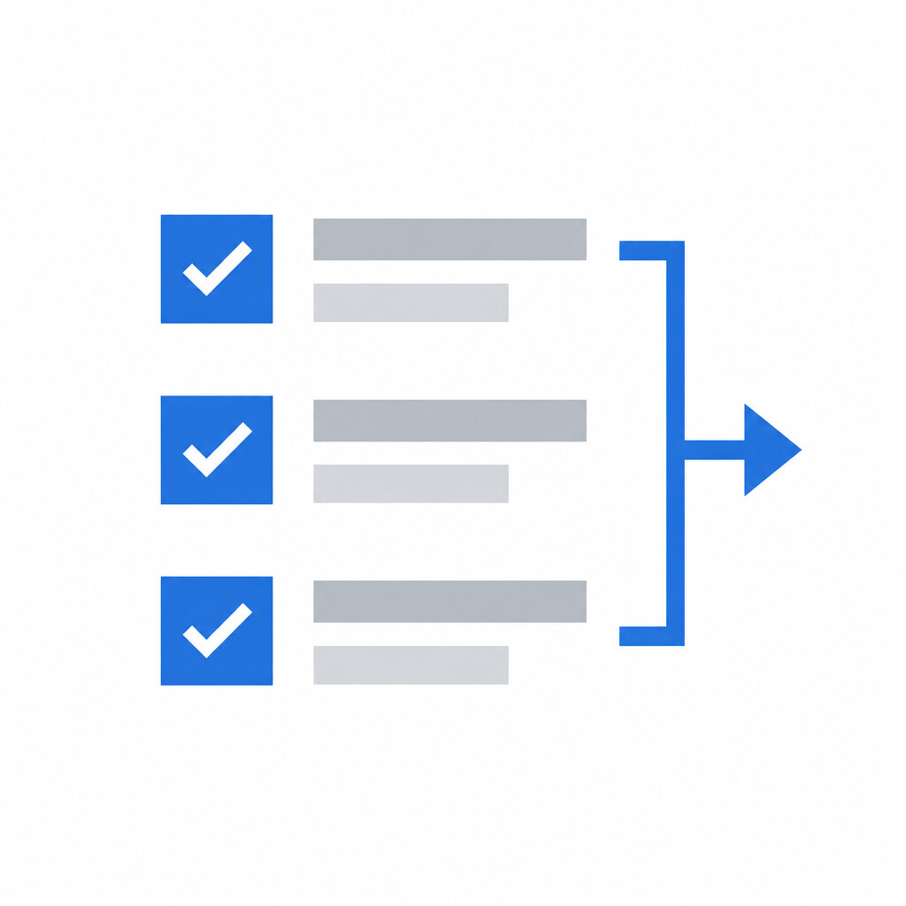
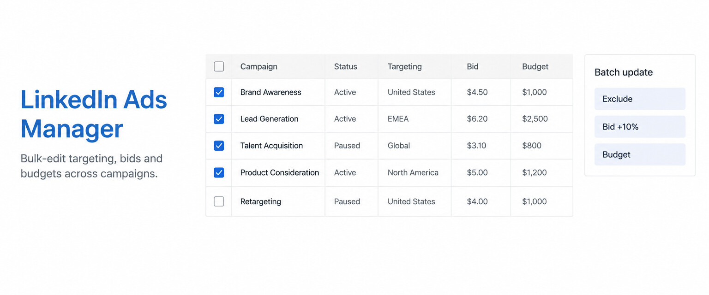
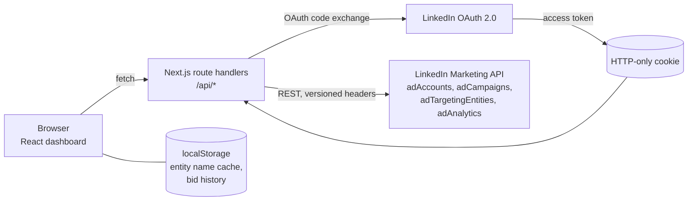

<p align="center">
  
</p>

<h1 align="center">LinkedIn Ads Manager</h1>

<p align="center">
  Edit targeting, bids and budgets on dozens of LinkedIn campaigns at once, instead of one at a time.
</p>

<p align="center">
  <a href="#features">Features</a> ·
  <a href="#architecture">Architecture</a> ·
  <a href="#getting-started">Getting started</a> ·
  <a href="DEPLOYMENT.md">Deployment</a>
</p>

<p align="center">
  
</p>

## Why

LinkedIn's Campaign Manager edits campaigns one at a time. When you run 30 campaigns and need to exclude a new list of companies, raise every bid by 10%, or move budget around before month end, that becomes an afternoon of clicking the same fields over and over, with plenty of room for mistakes.

This tool talks to the LinkedIn Marketing API directly and lets you select many campaigns, make one change, and apply it to all of them in a single batch.

## Features

- **Campaign table.** Every campaign in an ad account with status, type, cost model, bid, daily and lifetime budget, and spend for any date range.
- **Batch targeting.** Add or remove exclusions across selected campaigns: industries, job functions, titles, companies, seniorities, skills and more. Typeahead search over LinkedIn's targeting entities, plus bulk paste of comma-separated values.
- **Common targeting view.** For a selection of campaigns, see which targeting criteria they all share and which differ before you change anything.
- **Audience size check.** Estimate the audience for a targeting change before applying it.
- **Batch bids and budgets.** Raise or lower bids and budgets by an amount or a percentage across the selection.
- **Bid history.** Every bid change is logged with the spend at the time of the change, and charted over time, so you can see whether a bump actually moved delivery.

## Architecture



**Thin server, typed client.** Next.js route handlers under `src/app/api` are the only code that holds the access token. They read it from an HTTP-only cookie set during the OAuth callback and call a single typed wrapper, `src/lib/linkedin-api.ts`, which handles versioned headers, pagination and URN encoding.

**Batch writes.** LinkedIn has no "update many campaigns" call. A batch is expanded into one `PARTIAL_UPDATE` per campaign, sent in sequence to stay inside rate limits, and the results are collected per campaign so a partial failure reports exactly which campaigns did not change.

**Targeting diffs, not overwrites.** Campaign targeting is a nested include/exclude tree of URNs. Rather than replacing it, the batch builder reads each campaign's current tree, applies only the requested additions or removals, and writes back the merged result. That keeps each campaign's existing, different targeting intact.

**URN to name resolution.** Targeting comes back as opaque URNs (`urn:li:organization:1234`). They are resolved to readable names in bulk and cached in the browser, so the table and the common-targeting view stay fast after the first load.

**Serverless-friendly.** No database. Everything the server needs comes from the API on each request, and long-lived UI state (name cache, bid history) lives in the browser, so it deploys to any Node or serverless host.

## Getting started

You need a LinkedIn developer app with Marketing API access (`r_ads_reporting`, `rw_ads`).

```sh
npm install
npm run dev   # http://localhost:3000
```

Create `.env.local`:

```sh
LINKEDIN_CLIENT_ID=...
LINKEDIN_CLIENT_SECRET=...
```

Add `http://localhost:3000/api/auth/linkedin/callback` to your LinkedIn app's authorized redirect URLs (the app derives the callback from its own origin), then sign in and pick an ad account. See [DEPLOYMENT.md](DEPLOYMENT.md) for production.

## Project structure

```
src/
  app/
    api/auth/linkedin/      OAuth start + callback
    api/accounts/           ad accounts
    api/campaigns/          list, spend, common-targeting, batch-update,
                            batch-bid-update, batch-budget-update, bid-history
    api/targeting/          entity search, name resolution, audience counts
    dashboard/              main UI
  components/               CampaignList, BatchUpdateModal, BulkBidAdjustmentModal,
                            BidHistoryGraph, DateRangeFilter
  lib/                      LinkedIn API client, caches, date ranges
  types/                    LinkedIn API types
```

## Tech stack

Next.js (App Router), React, TypeScript, Tailwind CSS, Recharts, LinkedIn Marketing API.

## Notes

The API version is pinned in `src/lib/linkedin-api.ts`. LinkedIn retires versions about a year after release, so bump it when calls start returning 426. Not affiliated with LinkedIn.
